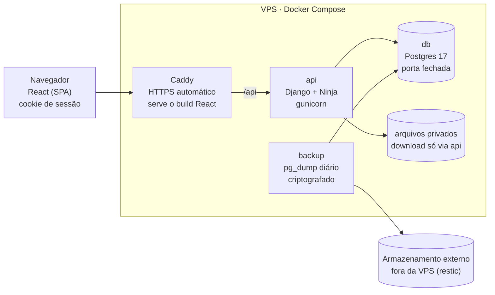

# MAPPA CFO 2.0 — Norte do Projeto

Atualizado em 23/10/2026. Versão viva (com comentários): https://claude.ai/artifact/5a8WqqHpRNTkULXcaGV8hN

## 1. O que é o sistema

O MAPPA CFO digitaliza o controle de anotações disciplinares dos cadetes do Curso de Formação de Oficiais. Ele substitui o papel: quem tem permissão registra a anotação, o comandante decide a punição (despacho) e o sistema gera o "mappa" em Excel para ciência e cumprimento.

Eram cerca de 205 usuários, com previsão de até 500. Rodava em Django 5.1 com templates e jQuery, Postgres 13, gunicorn e nginx numa VM do Google Cloud, hoje desligada.

| Perfil | O que faz hoje |
| --- | --- |
| Cadete | Vê as próprias anotações (notificadas e despachadas) e baixa os mappas publicados |
| Cadete com permissão de anotar | Anota outros cadetes |
| Oficial | Anota cadetes |
| Oficial comandante | Anota, despacha, edita despachos, exclui, exporta e publica o mappa |

Ciclo de uma anotação:

1. Alguém autorizado cria a anotação (positiva ou negativa). Ela fica com status `notificada`.
2. O comandante despacha. Negativa recebe punição (pernoite, revista ou outros) e data de cumprimento, e vira `despachada`. Positiva pode compensar uma negativa pendente: as duas são apagadas.
3. O comandante exporta as despachadas para Excel. As anotações exportadas são apagadas do banco.
4. O comandante torna o arquivo visível, e os cadetes baixam o mappa.

## 2. O que a nova versão busca resolver

A versão 2.0 transforma uma ferramenta interna em um produto vendável para a PM: seguro, auditável, administrado pelos próprios oficiais e barato de manter. É um projeto novo, com outro repositório, dono e domínio. Os dados atuais só entram por migração controlada.

| Objetivo | Por quê |
| --- | --- |
| Sair do GCP para uma VPS por assinatura | Custo desproporcional para no máximo 500 usuários |
| Tudo em containers (dev e produção) | O mesmo ambiente na máquina e no servidor, deploy repetível |
| Nova stack de frontend | Interface melhor e estudo de frontend |
| Login e dados tratados com segurança | Hoje há falhas graves (seção 3) |
| Painel administrativo para os oficiais | Cadastro, turmas e permissões sem depender do desenvolvedor |
| Histórico e auditoria | Num sistema disciplinar, nada some sem registro de quem fez |
| Automações | Recuperação de senha e cadastro de alunos em lote (escopo ainda a definir) |

O jeito de trabalhar também faz parte do objetivo: cada fase revisa conceitos e inclui testes manuais antes de automatizar.

## 3. Diagnóstico do sistema atual

O sistema antigo foi desligado, então nada é corrigido nele: tudo abaixo vira requisito da 2.0. As quatro falhas críticas aparecem como (urgente) no roteiro e precisam estar resolvidas antes do primeiro usuário real.

**Críticas**

| Falha | Onde | Efeito |
| --- | --- | --- |
| Exclusão sem checar cargo | `excluir_anotacao_view` | Qualquer cadete logado apaga qualquer anotação via POST (IDs sequenciais) |
| Login compara texto puro | `login_view`: `senha == usuario.senha` | Quem tem o banco entra digitando o hash; 27 de 205 senhas estão em texto puro |
| Dump do banco no git | `anotacao_cfo_backup.sql` | Nomes, numéricas, senhas e anotações no histórico do repositório |
| Planilhas em `/media/` público | `ArquivoExportado` | `visibilidade` só esconde da lista; a URL abre para qualquer um, e "limpar histórico" deixa o arquivo no disco |

**Bugs funcionais**

- Editar despacho sem mudar a data sempre falha: a checagem de data duplicada encontra a própria anotação.
- `despacho` tem `max_length=10` e recebe o texto livre de "Outros": erro 500 no Postgres.
- Despachar sem data gera erro 500 (`strptime(None)` antes de validar).
- Exportar e compensar com positiva **apagam** anotações: o histórico disciplinar se perde.
- A "última segunda" das estatísticas é calculada como domingo.
- A mensagem de erro da exportação mostra a exception crua ao usuário.
- No histórico, um comandante altera a visibilidade de arquivo de outro.
- O nome digitado na exportação vira caminho no disco: "MAPA ESCOLAR N°014/2026" criou a pasta `MAPA ESCOLAR N°014/` com o arquivo `2026.xlsx`.

**Estruturais (não repetir na 2.0)**

- Usuário próprio (`UserMilitar`) com senha manual, sem o `login()` do Django: sem troca de sessão, sem `is_active`, sem permissões.
- Login aceita nome, que não é único; `numerica` também não tem `unique`.
- Sem limite de tentativas de login.
- `SECRET_KEY` e `DEBUG=True` no código; configuração de produção fora do repositório e sem padrão.
- `status` sem `choices`; consultas N+1 nas listas e na exportação.
- `pandas` e `numpy` só para gerar uma planilha.
- `tests.py` vazio; `requirements.txt` em UTF-16 e sem `gunicorn` nem driver do Postgres.
- Backup = um `.sql` solto, sem rotina nem teste de restauração.

## 4. Arquitetura alvo

Uma API em Django, um frontend React separado e um Postgres, cada um num container, atrás de um Caddy que cuida do HTTPS. O navegador fala com um único domínio, então a autenticação usa cookie de sessão + CSRF, sem JWT no localStorage.



Só as portas 80 e 443 do Caddy ficam abertas; banco e arquivos só são alcançados pela api, e o backup sai da VPS todo dia.

| Camada | Escolha | Observação |
| --- | --- | --- |
| Backend | Django 5.2 LTS + Django Ninja, Python 3.13 | Ninja: API tipada e leve; o admin do Django fica só para o desenvolvedor |
| Frontend | React + TypeScript + Vite, TanStack Query, React Router | Tailwind + shadcn/ui para componentes |
| Banco | Postgres 17 | O 13 atual saiu de suporte em nov/2025 |
| Proxy | Caddy | HTTPS automático; serve o build do frontend e repassa `/api` |
| Arquivos | Volume privado + download por view com checagem de permissão | Nunca `/media/` público |
| Dependências | `uv` (Python) e `pnpm` (frontend), com lockfile | |
| Qualidade | pytest-django, ruff, Vitest, GitHub Actions | |

**Containers (Docker Compose)**

| Serviço | Dev | Produção |
| --- | --- | --- |
| `db` | Postgres com volume local | Postgres com volume, sem porta exposta |
| `api` | `runserver` com reload | gunicorn |
| `web` | Vite dev server com hot reload | Build estático copiado para o Caddy |
| `proxy` | Opcional | Caddy na 80/443 |
| `backup` | — | `pg_dump` diário criptografado para fora da VPS (restic) |

Um `compose.yaml` base, um `compose.override.yaml` para dev e um `compose.prod.yaml`. Segredos só em `.env`, com `.env.example` versionado.

**Modelo de dados**

- **Usuario** (`AbstractUser`, criado na primeira migração): `numerica` única como login, nome, e-mail, turma, `deve_trocar_senha`, `is_active`.
- **Grupos e permissões** no lugar de `cargo`: Cadete, Oficial, Comandante, Administrador. Permissões: anotar, despachar, exportar, gerenciar usuários.
- **Turma**: nome, ano de ingresso, ativa ou arquivada.
- **Anotacao**: tipo, motivo, cadete, autor, `status` com choices (notificada, despachada, compensada, cumprida, arquivada, anulada). Nada é apagado.
- **Despacho**: tipo de punição (tabela gerida pelo painel, no lugar do texto livre "Outros"), data de cumprimento, quem despachou.
- **Compensacao**: liga a positiva à negativa que ela anula.
- **Mappa**: arquivo gerado, publicado ou não, e as anotações que ele contém.
- **Auditoria**: django-simple-history nas tabelas acima.

**Estrutura do repositório**

```
mappacfo-pm/
├── backend/        # Django: config/, contas/, anotacoes/, mappas/
├── frontend/       # React + Vite
├── infra/          # Caddyfile, scripts de backup e deploy
├── compose.yaml
├── compose.override.yaml
├── compose.prod.yaml
├── .env.example
└── docs/           # este norte, decisões (ADRs), runbook
```

## 5. Roteiro por fases

Dez fases em ordem, todas no repositório novo `mappacfo-pm`; o sistema antigo só serve de referência. As correções da seção 3 estão marcadas como **(urgente)** nas fases 2, 3 e 5 e bloqueiam o primeiro usuário real. Cada fase lista o que revisar e o que testar à mão antes do teste automatizado.

O passo a passo completo de cada fase está em [plano/](plano/README.md).

### Fase 0 — Repositório e dados legados

- [x] Repositório `mappacfo-pm` criado em `C:\Projects`, com este norte em `docs/`
- [x] Backups do sistema antigo em `backups/legacy/`, fora do git
- [ ] Criptografar os backups legados (7-Zip com AES ou age) e apagar as cópias soltas, inclusive no repositório antigo
- [ ] Restaurar `backup_22_10.dump` num Postgres em container, só para estudar os dados e preparar a migração

**Testar à mão:** `git status` não pode listar nada de `backups/`; restaurar o dump com `pg_restore` e contar usuários e anotações.

### Fase 1 — Fundação

- [ ] Estrutura da seção 4, `.env.example` desde o primeiro commit
- [ ] Compose com `db` + `api`; Django sobe e conecta no Postgres
- [ ] Settings por variável de ambiente (`DEBUG`, `SECRET_KEY`, `ALLOWED_HOSTS`, banco)
- [ ] CI: ruff + pytest a cada push

**Revisar:** imagem x container x volume, camadas do Dockerfile, rede do compose, 12-factor.

**Testar à mão:** derrubar e subir os containers e confirmar que os dados do volume continuam; entrar no banco com `psql` dentro do container.

### Fase 2 — Contas e autenticação

- [ ] `Usuario` customizado na primeira migração, login pela numérica
- [ ] Grupos e permissões criados por migração de dados
- [ ] Endpoints de login, logout, "quem sou eu" e troca de senha (sessão + CSRF)
- [ ] **(urgente)** Senha só por `check_password`; nenhuma senha legada aproveitada, todos trocam no primeiro acesso
- [ ] Limite de tentativas (django-axes) e troca obrigatória no primeiro acesso

**Revisar:** hash de senha (PBKDF2/Argon2), sessão x token, CSRF, session fixation, cookies `Secure`/`HttpOnly`/`SameSite`.

**Testar à mão:** fluxo inteiro com `curl` ou Bruno/Insomnia, inspecionando os cookies; errar a senha até bloquear.

### Fase 3 — Domínio: anotações, despacho, compensação

- [ ] Models da seção 4 com `status` em choices e restrições no banco
- [ ] Regras numa camada de serviço (não nas rotas): criar, despachar, compensar, anular
- [ ] **(urgente)** Permissão checada em toda rota, com teste do cadete tentando anular ou excluir; cadete só vê o que é dele
- [ ] **(urgente)** Despacho: data obrigatória, punição vinda da tabela de tipos e checagem de data duplicada que ignora a própria anotação
- [ ] Histórico com django-simple-history
- [ ] Testes de cada regra e de cada permissão negada

**Revisar:** transações, constraints, `select_related`/`prefetch_related`, autorização por objeto.

**Testar à mão:** pela documentação interativa do Ninja (`/api/docs`), cada perfil tentando ações que não pode.

### Fase 4 — Frontend

- [ ] Projeto Vite + TS no container `web`, proxy para `/api` no dev
- [ ] Login, layout por perfil e rotas protegidas
- [ ] Telas: minhas anotações (cadete), relação de cadetes e anotar (oficial), despachar e despachadas (comandante)
- [ ] Estados de carregando, vazio e erro em toda tela; funciona no celular

**Revisar:** componentes e estado, TanStack Query (cache, invalidação), formulários controlados, acessibilidade básica.

**Testar à mão:** cada tela no celular real; derrubar a API e ver como a tela reage.

### Fase 5 — Mappa e arquivos

- [ ] Gerar o Excel com `openpyxl` direto, a partir das anotações despachadas
- [ ] Exportar arquiva as anotações (não apaga) e liga ao Mappa
- [ ] **(urgente)** Publicar/despublicar e download só por view autenticada
- [ ] Nome do arquivo gerado pelo sistema; o título digitado fica só no banco

**Testar à mão:** copiar o link de download e abrir numa aba anônima: tem que negar.

### Fase 6 — Painel administrativo

- [ ] Usuários: criar, editar, desativar, resetar senha, mudar grupo
- [ ] Turmas: criar, arquivar, mover cadetes
- [ ] Tipos de punição
- [ ] Importação de cadetes por CSV/XLSX com prévia e validação antes de gravar
- [ ] Tela de auditoria: quem fez o quê e quando

**Testar à mão:** importar uma planilha com erros de propósito (numérica repetida, turma inexistente).

### Fase 7 — Automações

- [ ] Recuperação de senha por e-mail (token com validade), no lugar do WhatsApp
- [ ] Senha temporária gerada pelo painel como alternativa
- [ ] Demais automações conforme a conversa com a PM

**Testar à mão:** Mailpit no compose de dev para ver os e-mails sem enviar de verdade.

### Fase 8 — Produção

- [ ] VPS com usuário sem root, chave SSH, firewall (só 22, 80, 443) e atualizações automáticas
- [ ] Domínio novo, Caddy com HTTPS, `compose.prod.yaml`
- [ ] Backup diário criptografado fora da VPS e um restore testado
- [ ] Monitoramento: GlitchTip ou Sentry para erros, Uptime Kuma para disponibilidade
- [ ] Script de migração a partir do `backup_22_10.dump` (usuários ativos e anotações pendentes), com senhas resetadas

**Testar à mão:** restaurar o backup numa máquina limpa e logar.

### Fase 9 — Piloto e entrega

- [ ] Piloto com uma turma e um comandante
- [ ] Manual curto do painel para os oficiais
- [ ] Runbook: deploy, backup, restore, o que fazer se cair

## 6. Checklist de segurança e LGPD

Vale para toda entrega: nada vai para produção com um item destes em aberto.

- [ ] Toda rota checa autenticação **e** permissão, com teste da permissão negada
- [ ] Senhas só com hash do Django; login com limite de tentativas
- [ ] Cookies `Secure`, `HttpOnly`, `SameSite`; HSTS ligado
- [ ] `DEBUG=False`, `ALLOWED_HOSTS` fechado, segredos só em `.env`
- [ ] Arquivos só por download autenticado
- [ ] Mensagens de erro genéricas para o usuário; detalhe só no log
- [ ] Nada de dados reais no repositório; dados de teste gerados (factory/faker)
- [ ] Backup criptografado, fora da VPS, com restore testado
- [ ] Auditoria de criação, edição, despacho e anulação
- [ ] Política de retenção: quanto tempo guardar anotações de cadetes formados
- [ ] Dependências atualizadas (Dependabot ou Renovate)

## 7. Decisões em aberto

- [ ] A PM exige dados hospedados no Brasil? Isso define o provedor da VPS.
- [ ] Quem é o controlador dos dados na LGPD, e quem é o operador?
- [ ] Propriedade do código, licença e suporte: venda, assinatura ou cessão?
- [ ] Cadastro de alunos: planilha da secretaria, integração com algum sistema da PM ou auto-cadastro com aprovação?
- [ ] Recuperação de senha: todo cadete tem e-mail confiável?
- [ ] Regras de punição: a regra "uma punição por cadete por dia" continua valendo?
- [ ] O sistema atende só o CFO ou outros cursos e unidades no futuro (multi-unidade)?
- [x] Frontend: React + TypeScript + Vite (decidido em 23/10/2026; registrar em `docs/adr/0001-frontend-react.md`).
